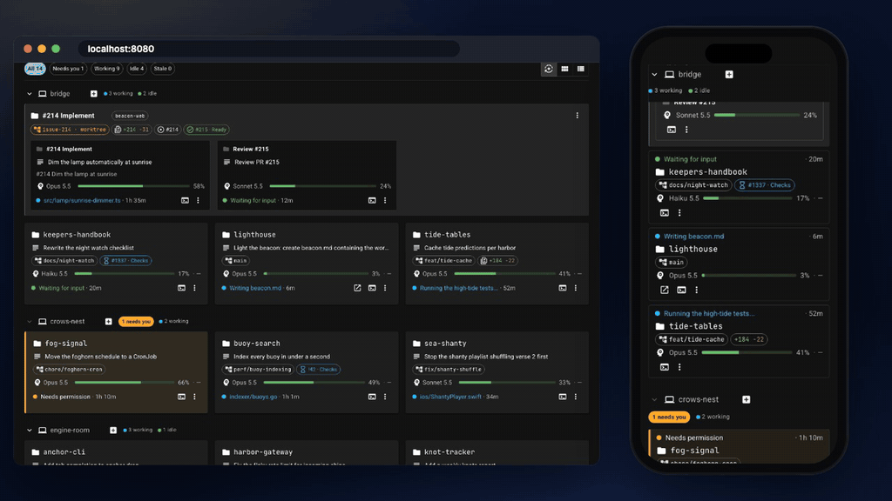
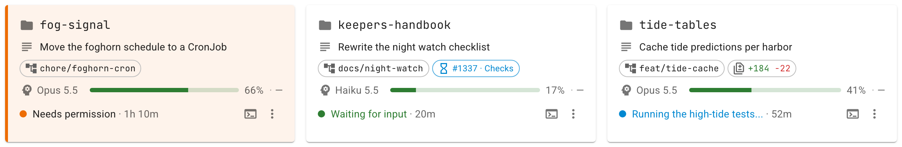
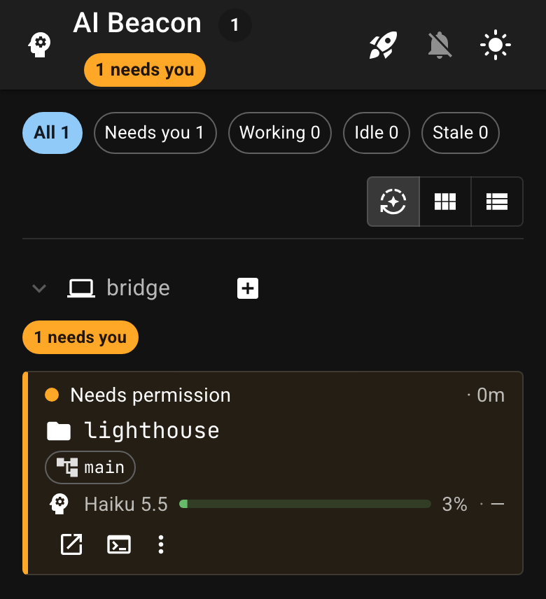
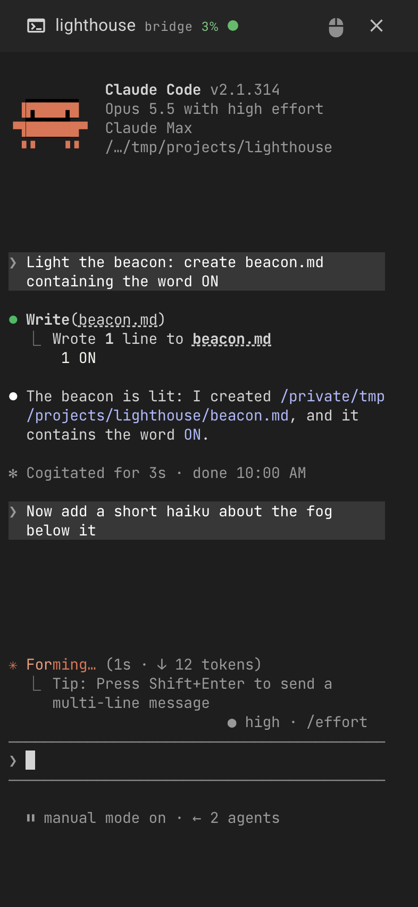
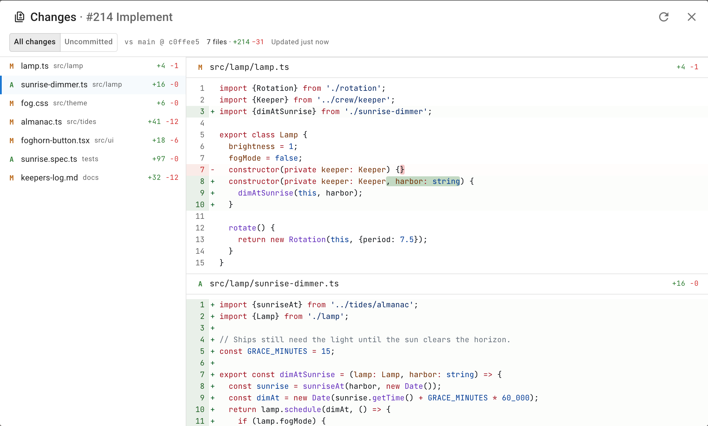
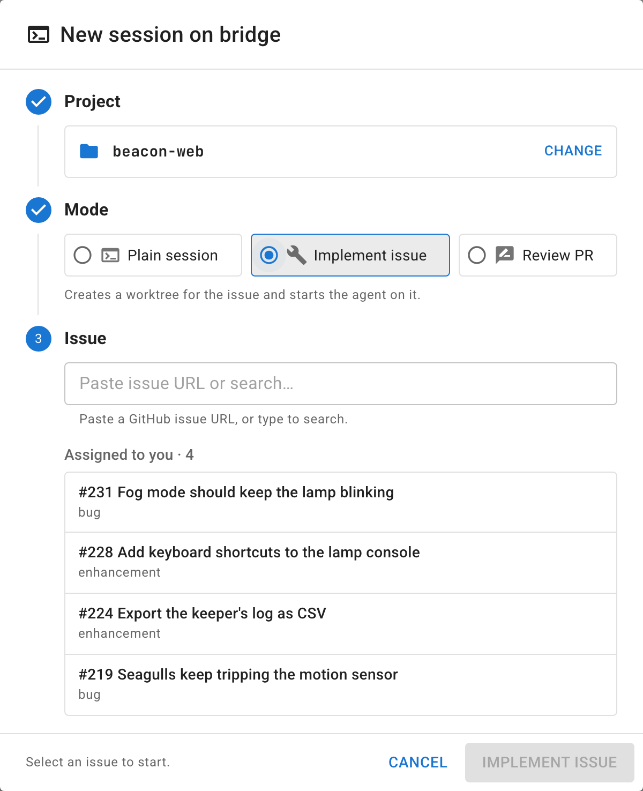
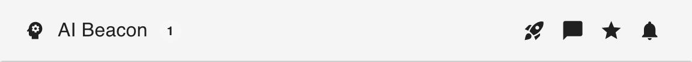

# AI Beacon

**Watch every coding agent on every machine, and step in the moment one needs you.**

<div align="center">

[Quick start](#quick-start) · [Features](#features) · [Deploy](#deploy) · [Docs](docs/README.md)

</div>

AI Beacon is a self-hosted dashboard for developers who run several Claude Code or OpenCode sessions at once, on one machine or many. A small CLI on each machine reports its sessions to the dashboard you host. From any browser that can reach it, your phone included, you see what every agent is doing, get a browser notification when one is waiting on you, and type straight into its terminal.

*Early access: binaries, the container image and the Helm chart are free to use today; the source follows after this validation phase.*



<div align="center">

<table>
<tr>
<td width="50%" align="center">

💻 **Run locally with Docker**

Dashboard in ~30s: one container, one port, one volume.

**[Run with Docker](#run-locally-with-docker) →**

</td>
<td width="50%" align="center">

☁️ **Try it in the cloud, free**

OpenShift Developer Sandbox: needs a free Red Hat account, reachable from your phone.

**[Deploy to the Sandbox](#deploy-to-openshift-developer-sandbox) →**

</td>
</tr>
</table>

</div>

<a id="why-ai-beacon"></a>
## 💡 Why AI Beacon

If you run more than a couple of agent sessions at once, the bottleneck is you noticing which one is stuck.

- **One page instead of cycling through terminal panes.** Every session on every machine shows whether it is working, idle, or waiting for you.
- **No SSH from your phone.** Each machine connects out to the dashboard, so you open no inbound ports on it; attach to a session's terminal from the browser and answer there.
- **Not tied to one agent or one machine.** Claude Code and OpenCode, on Linux, macOS and Windows, all on a dashboard you host.
- **Sessions can hand off work.** Ask one session to pass its findings to another instead of copy-pasting between terminals.

**What leaves your machines:** terminal output and session details go only to the dashboard you run, and PR status comes from GitHub or GitLab. `ai-beacon install` asks before adding its tagged hooks to your agent's settings, and [`ai-beacon uninstall`](docs/connect-agent.md#uninstalling) removes them.

Built by Marc Nuri, who runs his own agent sessions on it every day across three machines.

<a id="features"></a>
## ✨ Features

### Know when an agent needs you

- **Live state on every session:** working, idle, or waiting for your permission or answer, also shown [in your terminal's title](docs/connect-agent.md#the-terminal-title-shows-the-agents-state).
- **Browser notifications** when a session needs permission, finishes, or opens a pull request, while a dashboard tab is open (it can be in the background). The "needs you" alert stays up until you act.

<picture>
  <source media="(prefers-color-scheme: dark)" srcset="docs/assets/session-states-dark.png">
  
</picture>

### Step in from anywhere

- **Browser terminal:** attach to a session from any device and type as if you were at the machine.
- **See what changed without attaching:** each session shows its lines added and removed; click to open a read-only diff of the whole branch or just the uncommitted work.
- **Manage sessions remotely:** rename them, end them, or bring a session's terminal window to the front on its machine.
- **Sessions that talk to each other:** in one session, say "tell the reviewer session about points 1 and 2", and the reviewer gets them as its next prompt. See [Inter-session messaging](docs/inter-session-messaging.md).

<p align="center">
  
  
</p>

<picture>
  <source media="(prefers-color-scheme: dark)" srcset="docs/assets/changes-viewer-dark.png">
  
</picture>

### Start work from the browser

- **New session dialog:** pick a machine's project, then a mode (*Plain session*, *Implement issue* or *Review PR*), then the issue or pull request. It remembers your last choice per machine.
- **Workflow prompts:** *Implement issue* and *Review PR* start the agent with an opinionated prompt (plan first, TDD, multi-persona review) and the issue or PR discussion preloaded. Reviews are never posted until you approve them. Override the prompts per machine.
- **GitHub, GitLab and Jira:** works with `gh` on GitHub and `glab` on GitLab, self-managed included (the dialog switches to merge requests and *Review MR*). *Implement issue* also takes a pasted Jira ticket URL.
- **Fresh worktrees:** run an issue or PR in a new git worktree, removed on exit if it has no uncommitted or untracked files.

<p align="center">
  <picture>
    <source media="(prefers-color-scheme: dark)" srcset="docs/assets/new-session-dark.png">
    
  </picture>
</p>

### See the whole fleet

- **One dashboard, many machines:** sessions grouped by device, each with model, context use, cost, branch, and PR or MR status with checks.
- **Runs where you do:** Claude Code and OpenCode on Linux, macOS and Windows (amd64 and arm64).

### Host it your way

- **Deploy:** Docker, Helm on Kubernetes or OpenShift, Hugging Face Spaces, or a native binary. See [Deploy](#deploy).
- **Sign in:** password, OIDC, OpenShift OAuth proxy, identity-aware reverse proxy, or your Hugging Face account. See [Authentication](docs/auth.md).

> [!NOTE]
> **Early access.** Binaries, the container image and the Helm chart are available now; the source will be published after this validation phase. AI Beacon supports **Claude Code** and **OpenCode** today, with more agents planned. Feedback is the point of this phase: please open an [issue](https://github.com/manusa/ai-beacon/issues) or a [discussion](https://github.com/manusa/ai-beacon/discussions).
>
> **Support:** Marc answers [Discussions](https://github.com/manusa/ai-beacon/discussions) personally, usually within 24 hours.

<a id="quick-start"></a>
## ⏱️ Quick start

Three steps to your first live session: start a dashboard, connect your machine, start a session. You need Docker (or a free OpenShift Developer Sandbox account) for the dashboard, and Claude Code or OpenCode on the machine you connect.

<a id="start-the-dashboard"></a>
### 1. Start the dashboard

Docker is the quickest way on a single machine. To use the dashboard from your phone, deploy it somewhere your phone can reach, such as the Developer Sandbox below. For Kubernetes, Hugging Face Spaces or the native binary, see [Deploy](#deploy).

<a id="run-locally-with-docker"></a>
#### Run locally with Docker

> Don't have Docker yet? Install it from [docs.docker.com/get-started](https://docs.docker.com/get-started/get-docker/). If you prefer Podman, replace `docker` with `podman` in every command below; the recipe is identical.

```bash
docker volume create ai-beacon
docker run -d --name ai-beacon --pull=always \
  -e AI_BEACON_AUTH_PASSWORD=demo \
  -p 127.0.0.1:8080:8080 \
  -v ai-beacon:/data \
  ghcr.io/manusa/ai-beacon:latest
```

Open <http://localhost:8080> and log in with password **demo**. The dashboard only listens on localhost; to reach it from your phone or another machine, use a [Deploy](#deploy) option with a real password, or the Sandbox.

> [!TIP]
> Keep the `/data` volume: it holds the agent token. Without it, each restart issues a new token and your agents drop off the dashboard until you re-run `ai-beacon install`.

<details>
<summary>Reading the agent token</summary>

The setup guide in step 2 already fills the token in for you. To read it yourself:

```bash
docker exec ai-beacon cat /data/token
```

</details>

<a id="deploy-to-openshift-developer-sandbox"></a>
#### Deploy to the OpenShift Developer Sandbox

The [Developer Sandbox](https://developers.redhat.com/developer-sandbox) is free and available to anyone with a Red Hat account. The same recipe works on any OpenShift cluster. You need `helm` and `oc`; log `oc` in with the login command from the Sandbox web console (*Copy login command*).

> [!TIP]
> No `helm` or `oc` on your machine? [Open AI Beacon in OpenShift Dev Spaces](https://workspaces.openshift.com#https://github.com/manusa/ai-beacon) and run the **Deploy to Developer Sandbox** command: it runs this recipe from a browser workspace that already has both tools.

```bash
# 1. Set the agent token
#    The token authenticates agents to the dashboard. Browser login uses
#    your OpenShift / Red Hat account via the OAuth Proxy sidecar, so there
#    is no password to manage. Only usernames listed in --set allowedUsers
#    can sign in; the snippet below allows your current OpenShift user.
export TOKEN=$(openssl rand -hex 32)

# 2. Install (into your current namespace; the sandbox assigns one for you)
helm install ai-beacon \
  oci://ghcr.io/manusa/charts/ai-beacon \
  --version 0.0.0-snapshot \
  --set openshift=true \
  --set oauthProxy.enabled=true \
  --set persistence.enabled=false \
  --set auth.token="$TOKEN" \
  --set allowedUsers="{$(oc whoami)}"

# 3. Get the dashboard URL
oc get route ai-beacon -o jsonpath='https://{.spec.host}'
```

Open the dashboard URL in your browser. You'll be redirected to OpenShift to log in with your Red Hat account, then asked to authorize the dashboard.

> [!NOTE]
> `--version 0.0.0-snapshot` is a rolling pre-release alias that tracks the latest build.
> It is required until a stable release is published.

<a id="connect-your-machine"></a>
### 2. Connect your machine

The dashboard starts empty. Click the **rocket icon** in the top bar (or **Get started** on the empty dashboard) to open the setup guide:

<div align="center">
  <picture>
    <source media="(prefers-color-scheme: dark)" srcset="docs/assets/app-bar-dark.png">
    
  </picture>
</div>

The guide detects your OS and gives you copy-ready commands. On the machine where you run your agent, they come down to:

```bash
# Download the CLI (macOS on Apple silicon shown; the guide picks yours)
curl -fL -o ai-beacon https://github.com/manusa/ai-beacon/releases/download/snapshot/ai-beacon-darwin-arm64
chmod +x ai-beacon

# Move it to its permanent place first: install records this path
mkdir -p ~/.local/bin && mv ai-beacon ~/.local/bin/

# ~/.local/bin is not on your PATH by default on macOS. If it isn't on yours,
# run this and append the same line to ~/.zshrc or ~/.bashrc
export PATH="$HOME/.local/bin:$PATH"

# Install the agent hooks (the setup guide shows this exact command,
# with your dashboard URL and agent token filled in)
AI_BEACON_URL='<dashboard-url>' AI_BEACON_AUTH_TOKEN='<token>' ai-beacon install
```

Builds for Linux, macOS and Windows on amd64 and arm64 are listed in [Native binaries](docs/connect-agent.md#native-binaries). `install` asks for confirmation, then hooks into Claude Code and OpenCode, whichever you have.

<a id="start-a-session"></a>
### 3. Start a session

```bash
ai-beacon session -- claude      # or: ai-beacon session -- opencode
```

The session appears on the dashboard within a few seconds. Click it to attach to its terminal from any browser, and turn on notifications with the bell icon in the top bar.

> [!TIP]
> After `install`, sessions you start with plain `claude` show up too, marked **Monitor only**: you see their state and details, but attaching a terminal needs the `ai-beacon session` wrapper.

To start sessions *from* the dashboard, a machine needs an `ai-beacon session` already running that knows where your repositories are: start it with [`AI_BEACON_PROJECTS_DIR`](#agent-configuration) set (or `projects_dirs` in `config.toml`). See [Spawning sessions from the dashboard](docs/multi-machine.md#spawning-sessions-from-the-dashboard).

Not showing up? See ["Session not appearing" troubleshooting](docs/connect-agent.md#session-not-appearing-troubleshooting).

<a id="deploy"></a>
## 🚀 Deploy

Every option runs the same dashboard; the setup guide walks you through connecting agents to any of them.

<a id="deploy-to-any-kubernetes-cluster"></a>
<a id="deploy-to-hugging-face-spaces"></a>

| Method | Best for |
|--------|----------|
| [Docker](#run-locally-with-docker) | Trying the dashboard on your own machine |
| [OpenShift Developer Sandbox](#deploy-to-openshift-developer-sandbox) | Free cloud dashboard, reachable from your phone |
| [Any Kubernetes cluster](docs/deploy.md#any-kubernetes-cluster) | Your own cluster, with Helm |
| [Hugging Face Spaces](docs/deploy.md#hugging-face-spaces) | Free cloud dashboard gated by your Hugging Face account |
| [Native binary](docs/deploy.md#native-binary) | No container runtime |

Every Helm value is documented in the [chart's README](charts/ai-beacon/README.md).

<a id="recommended-tools"></a>
## 🛠️ Recommended tools

AI Beacon works out of the box, but some features need these tools on the machines running your agents:

| Tool | What it unlocks |
|------|----------------|
| [`git`](https://git-scm.com/) | Branch display, changes viewer, worktree sessions |
| [`gh`](https://cli.github.com/) (authenticated) | PR status and checks on session cards; *Implement issue* and *Review PR* on GitHub projects |
| [`glab`](https://gitlab.com/gitlab-org/cli) (authenticated) | The same for GitLab projects, self-managed included |

Without them the dashboard still tracks every session's model, context use, cost, and duration. See [GitHub integration](docs/github.md).

<a id="agent-configuration"></a>
## ⚙️ Agent configuration

The setup guide covers installing the CLI and connecting to the dashboard. These environment variables are optional but useful:

| Variable | Purpose | Default |
|----------|---------|---------|
| `AI_BEACON_PROJECTS_DIR` | Base directories of your repositories. Enables starting sessions and worktree workflows from the dashboard. Accepts one path or a list joined by the OS path separator (`:` on Unix, `;` on Windows). | _(disabled)_ |
| `AI_BEACON_DEVICE_NAME` | Friendly name shown in the dashboard for this machine. | hostname |

Set them in your shell profile (e.g. `~/.zshrc`) so they apply to every session:

```bash
export AI_BEACON_PROJECTS_DIR=~/projects
export AI_BEACON_DEVICE_NAME=macbook
```

Jira tickets, server flags, Helm values, the `config.toml` file and the data directory layout are all in [Configuration](docs/configuration.md).

<a id="documentation"></a>
## 📖 Documentation

Everything past your first session lives in [`docs/`](docs/README.md): multi-machine setup, deployment options, authentication (OIDC, proxy-header), GitHub and GitLab integration, workflow prompts, inter-session messaging, the full configuration reference, and troubleshooting.

<a id="contributing"></a>
<a id="feedback"></a>
## 🤝 Feedback

The source isn't public yet, so the most useful contribution right now is trying AI Beacon and telling us what broke or what's missing, in [Discussions](https://github.com/manusa/ai-beacon/discussions) or [Issues](https://github.com/manusa/ai-beacon/issues). Star or watch the repository to follow along until the source is published.

<a id="license"></a>
## 📜 License

[Apache License 2.0](LICENSE)
